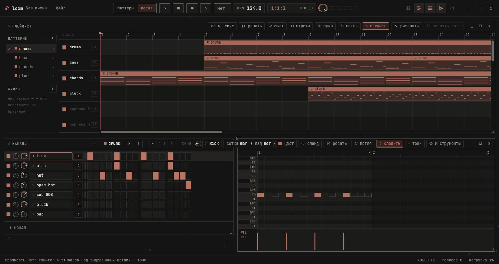

<div align="center">
  
  <h1>loom</h1>
  <p>A portable digital audio workstation for Windows.</p>
  <p><strong>English</strong> · <a href="README.ru.md">Русский</a></p>
  <p><a href="https://github.com/b4demus/loom/releases/latest"></a></p>
</div>



Loom brings a step sequencer, piano roll, playlist and mixer into a single workspace. Sketch a pattern with the built-in drum kit, turn it into an arrangement, then record and mix audio in the same project.

## Get started

1. Download the Windows x64 portable ZIP. [GitHub Releases](https://github.com/b4demus/loom/releases/latest)
2. Extract the whole archive into a folder you can write to and open `loom.exe`.
3. Press **Space** to play. Use **F5** for the playlist, **F6** for the channel rack, **F7** for the piano roll and **F9** for the mixer.

Try the built-in demo with `.\loom.exe --demo --song` from the extracted folder. Click the Loom logo in the top left to open settings and switch between English and Russian.

| System component | Used for |
| --- | --- |
| Windows 10 or 11, x64 | Portable desktop app and WASAPI audio |
| Microsoft Edge WebView2 Evergreen Runtime | Interface. [Microsoft download](https://developer.microsoft.com/microsoft-edge/webview2/#download-section) |
| Microsoft Visual C++ Redistributable, x64 | ONNX Runtime for stem separation. [Microsoft download](https://learn.microsoft.com/en-us/cpp/windows/latest-supported-vc-redist) |

Loom settings, the plugin scan cache and downloaded models travel with the extracted folder in `data/`. Keep `portable.txt` beside the executable to activate that mode. Recordings, rendered clips and stems go beside a saved project, or into `data/` until you save it. Projects may reference media and plugins by path. When moving to another PC, bring the media and make the same plugins available.

## Make music

| Workspace | What you can do |
| --- | --- |
| **Sequence** | Program drums in the channel rack, write notes in the piano roll and arrange patterns and audio clips in the playlist. |
| **Play and record** | Use the built-in synth, sampler and drum kit. Record audio and notes, monitor inputs and route audio through the mixer. |
| **Mix** | Host 64-bit VST2 and VST3 instruments and effects. Use **Shift + mouse wheel** over an effect to move it up or down the insert chain. |
| **Edit and export** | Edit clips, import and export MIDI, save `.loom` projects and render 24-bit WAV. |
| **Split stems** | Use an audio clip’s menu to separate vocals, drums, bass and other instruments on the CPU. The first run downloads the 316 MB HTDemucs model. Inference runs locally and works offline after that. |

## Build from source

Use PowerShell, stable Rust for `x86_64-pc-windows-gnu` and w64devkit. The build looks for the local toolchain layout `../.tools/rust-daw` with `cargo/bin`, `rustup` and `gcc/w64devkit/bin`. Set `LOOM_TOOLCHAIN` to use that layout at another path. With a standalone toolchain, put Rust and w64devkit on `PATH` and set `$env:LIBRARY_PATH = (Resolve-Path .cargo/libstub).Path` for w64devkit. Node.js enables the UI test suite.

```powershell
.\build.ps1 -Portable
```

The script runs the tests and writes the ZIP and its SHA-256 checksum to `dist/`. It prepares the pinned ONNX Runtime automatically. Set `LOOM_ORT_DIR` to use an existing copy.

For a local ASIO build, set `CPAL_ASIO_DIR` to the Steinberg SDK root and `LIBCLANG_PATH` to the directory containing `libclang.dll`, then run `.\build.ps1 -Asio`. [Detailed guide in Russian](docs/guide.ru.md)

<sub>Created by b4demus. Third-party notices are in <a href="licenses/">licenses/</a> and next to the corresponding vendored sources.</sub>
