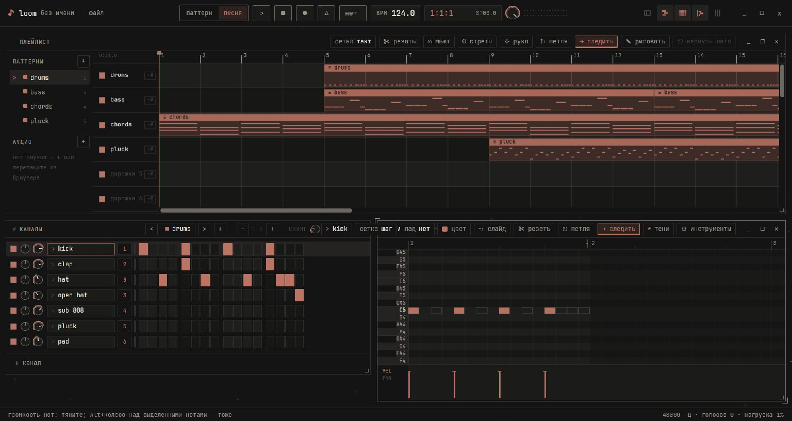

<div align="center">
  
  <h1>loom</h1>
  <p>Портативная цифровая аудиостанция для Windows.</p>
  <p><a href="README.md">English</a> · <strong>Русский</strong></p>
  <p><a href="https://github.com/b4demus/loom/releases/latest"></a></p>
</div>



В Loom шаговый секвенсор, пиано-ролл, плейлист и микшер собраны в одном рабочем пространстве. Набросайте паттерн на встроенном наборе ударных, соберите аранжировку, запишите и сведите звук в том же проекте.

## Быстрый старт

1. Скачайте портативный ZIP для Windows x64. [Релизы на GitHub](https://github.com/b4demus/loom/releases/latest)
2. Распакуйте весь архив в папку с правом записи и запустите `loom.exe`.
3. **Пробел** запускает воспроизведение. **F5** открывает плейлист, **F6** — стойку каналов, **F7** — пиано-ролл, **F9** — микшер.

Чтобы открыть демопроект, выполните `.\loom.exe --demo --song` из распакованной папки. Нажмите на логотип Loom в левом верхнем углу, чтобы открыть настройки и переключить язык.

| Системный компонент | Для чего нужен |
| --- | --- |
| Windows 10 или 11, x64 | Портативное приложение и звук через WASAPI |
| Microsoft Edge WebView2 Evergreen Runtime | Интерфейс. [Скачать с сайта Microsoft](https://developer.microsoft.com/microsoft-edge/webview2/#download-section) |
| Microsoft Visual C++ Redistributable, x64 | ONNX Runtime для разделения на стемы. [Скачать с сайта Microsoft](https://learn.microsoft.com/en-us/cpp/windows/latest-supported-vc-redist) |

Настройки Loom, кэш сканирования плагинов и загруженные модели хранятся в `data/` внутри распакованной папки. Портативный режим включается файлом `portable.txt` рядом с программой. Записи, отрендеренные клипы и стемы сохраняются рядом с проектом, а до первого сохранения попадают в `data/`. Проекты могут ссылаться на внешние аудиофайлы и плагины по пути. При переносе на другой ПК скопируйте аудиофайлы и подключите те же плагины.

## Работа со звуком

| Раздел | Возможности |
| --- | --- |
| **Секвенсор** | Программируйте ударные в стойке каналов, пишите ноты в пиано-ролле и собирайте паттерны и аудиоклипы в плейлисте. |
| **Инструменты и запись** | Играйте на встроенном синтезаторе, сэмплере и ударных. Записывайте звук и ноты, слушайте входы и направляйте их в микшер. |
| **Микшер** | Подключайте 64-битные инструменты и эффекты VST2 и VST3. Наведите курсор на эффект и прокрутите **Shift + колесо**, чтобы переместить его вверх или вниз по цепочке. |
| **Монтаж и экспорт** | Редактируйте клипы, импортируйте и экспортируйте MIDI, сохраняйте проекты `.loom` и рендерите WAV 24 бит. |
| **Разделение на стемы** | В меню аудиоклипа можно выделить вокал, ударные, бас и остальные инструменты. При первом запуске скачивается модель HTDemucs объёмом 316 МБ. Обработка идёт локально на CPU и дальше работает офлайн. |

## Сборка из исходников

Понадобятся PowerShell, стабильный Rust для `x86_64-pc-windows-gnu` и w64devkit. Скрипт ищет тулчейн в `../.tools/rust-daw` с подпапками `cargo/bin`, `rustup` и `gcc/w64devkit/bin`. Для той же структуры в другом месте задайте `LOOM_TOOLCHAIN`. Если Rust и w64devkit установлены отдельно, добавьте их в `PATH` и задайте `$env:LIBRARY_PATH = (Resolve-Path .cargo/libstub).Path` для w64devkit. При наличии Node.js скрипт также запускает тесты интерфейса.

```powershell
.\build.ps1 -Portable
```

Скрипт запускает тесты и сохраняет ZIP с контрольной суммой SHA-256 в `dist/`. Нужная версия ONNX Runtime подготавливается автоматически. Путь к уже скачанной версии можно указать через `LOOM_ORT_DIR`.

Для локальной сборки с ASIO укажите путь к Steinberg ASIO SDK в `CPAL_ASIO_DIR` и папку с `libclang.dll` в `LIBCLANG_PATH`, затем запустите `.\build.ps1 -Asio`. [Подробный справочник](docs/guide.ru.md)

<sub>Автор — b4demus. Уведомления о сторонних компонентах лежат в <a href="licenses/">licenses/</a> и рядом с их исходниками.</sub>
